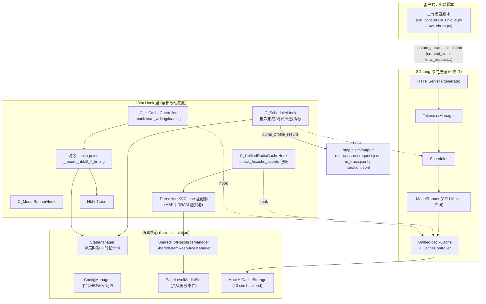
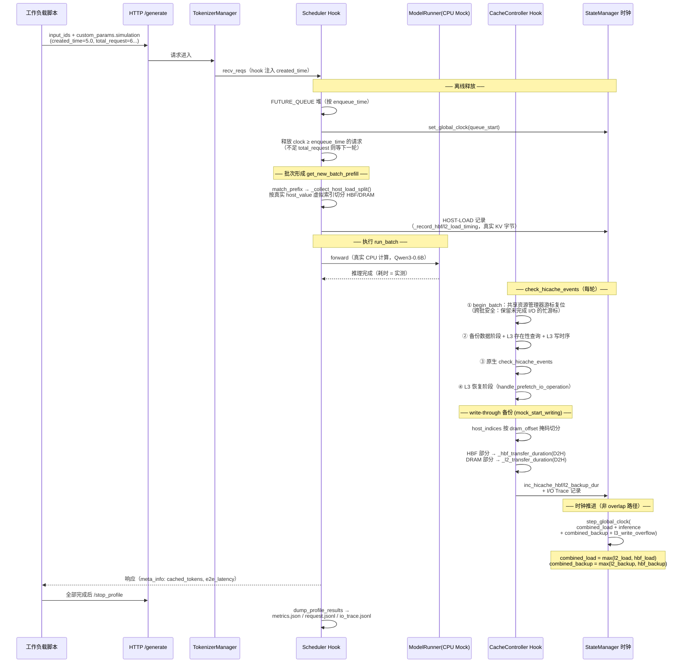
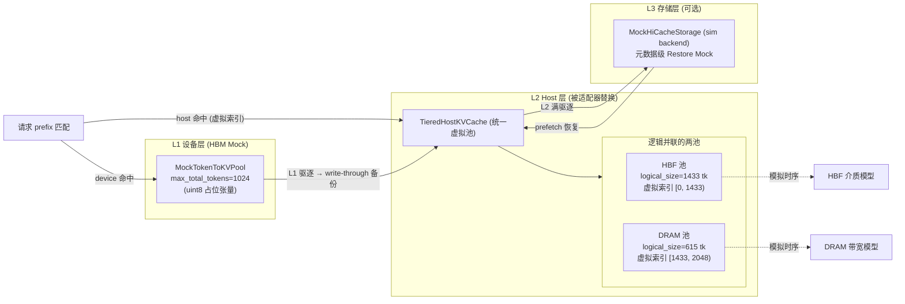
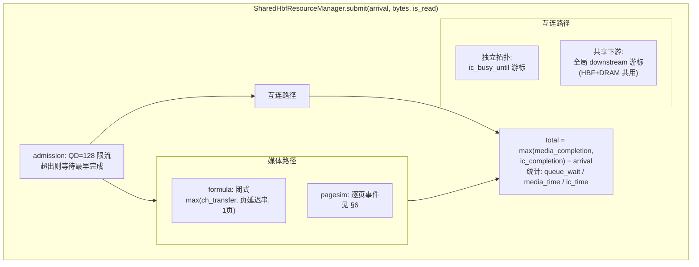
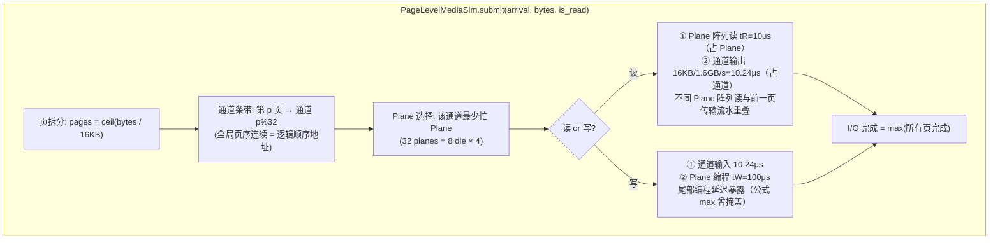

# HiSim + HBF 仿真框架架构与流程说明

> 适用版本：分支 `develop_dqy_0.5.19_qwen3_hbf`，sglang 0.5.19，Qwen3-0.6B CPU Mock
> 本文是理解当前实现的自助文档：先看总览，再按需深入各章

---

## 1. 一图总览



**三条铁律**：
1. SGLang 原生代码 **0 行修改** —— 所有逻辑通过 `install_class_hooks` 注入（`launch_server.py:15-33`）
2. `HISIM_HBF_ENABLE=0` 时 HBF 适配器不安装，走原生 DRAM 路径，**行为与基线逐字节一致**
3. Token 守恒：`L1_device + L2_host + Recomputed = actual_input`，每个请求日志验证

---

## 2. 模块地图

```
src/hisim/
├── hook/                        # Hook 框架（类级/模块级注入）
│   ├── base_hook.py             #   BaseHook: hook(target) 替换方法
│   └── class_hook_entry.py      #   install_class_hooks
├── time_predictor/              # 推理时长预测器（InferTimePredictor）
├── simulation/
│   ├── sglang/                  # ★ SGLang 集成层
│   │   ├── launch_server.py     #   入口：装 hooks 后调原生 launch_server
│   │   ├── sglang_hook.py       #   ★ 全部 9 个 C_* Hook（~3400 行）
│   │   ├── hbf_tiered_pool.py   #   ★ TieredHostKVCache + PlacementPolicyV0
│   │   ├── sglang_mock_class.py #   Mock 权重/attention/KV池/HiCacheStorage
│   │   └── hbf_io_trace.py      #   I/O Trace 记录与窗口分析 (P3)
│   ├── hbf_shared_resource.py   # ★ 共享资源管理器（媒体+互连+下游）
│   ├── hbf_page_sim.py          # ★ 页级离散事件介质模拟器 (P1)
│   ├── hbf_channel_model.py     #   简化通道模型 + 微基准
│   ├── manager/
│   │   ├── state.py             #   StateManager: 全局时钟/计时累计
│   │   ├── config.py            #   ConfigManager: 平台+HBF+KV 配置
│   │   └── env.py               #   Envs: 输出目录等
│   ├── types.py                 #   HBFConfig / RequestStats
│   └── utils.py                 #   calc_metrics (TTFT/TPOT/吞吐)
└── dataset/                     # 数据集（sharegpt/weka/随机/前缀）
```

**安装的 Hook 类**（`launch_server.py`）：

| Hook | 挂点 | 职责 |
|---|---|---|
| `C_TokenizerManagerHook` | `_send_one_request` | 透传 created_time 到调度侧 |
| `C_SchedulerHook` | `get_new_batch_prefill` / `run_batch` 等 | **离线时间戳释放、host 归因、时钟推进、指标** |
| `C_ModelRunnerHook` | forward 相关 | CPU Mock 推理路径 |
| `C_UnifiedRadixCacheHook` | `check_hicache_events` | **HBF 适配器安装、批开始、L3 三阶段驱动**（sglang ≥0.5.10 主路径） |
| `C_HiCacheController` | `start_writing` / `start_loading` | **备份/恢复的时序计算与记录（choke point）** |
| `C_HiRadixCacheHook` | 同上 | 旧版 sglang ≤0.5.9 兼容（legacy） |
| `C_StorageBackendFactory` | 存储后端 | L3 sim 后端接入 |
| `C_SchedulerProfilerManagerHook` | `profile` | `/stop_profile` → `dump_profile_results` |
| `C_HybridCacheControllerHook` | 控制器初始化 | 参数注入 |

---

## 3. 请求生命周期（离线时间戳仿真）

HiSim 采用**离线仿真**：所有请求带 `created_time` 一次性提交，按仿真时钟顺序释放，保证确定性与可复现。



**时钟推进公式**（`sglang_hook.py:3231-3250`，这是所有时序的汇聚点）：

```
非 overlap 调度：
  clock += combined_load_dur          # max(HBF加载, DRAM加载) —— 并联介质取 max
          + current_inference_dur     # 本轮真实推理时长
          + combined_backup_dur       # max(HBF备份, DRAM备份)
          + l3_write_overflow         # max(0, L3写 - (load+infer+backup))  [Barrier 模式]

overlap 调度：
  clock += max(combined_load - last_inference, 0)   # 加载超出上轮推理的部分
          + current_inference_dur
  response_time = clock + combined_backup + l3_write_overflow
```

---

## 4. KV Cache 分层与 HBF 适配器

### 4.1 三层缓存结构



### 4.2 虚拟索引空间（“并联”的实现核心）

```python
# hbf_tiered_pool.py
dram_offset = hbf_pool.logical_size          # 1433
# SGLang 看到的 host 池: 统一 [0, logical_size)
#   HBF:  [0, dram_offset)        ← hbf_pool.alloc() 直出
#   DRAM: [dram_offset, total)    ← dram_pool.alloc() + dram_offset
_is_hbf(idx) = idx < dram_offset
```

**效果**：SGLang 原生的 `host_value`、`_transfer_num_bytes`、驱逐逻辑完全无感知——它们操作的都是虚拟索引；适配器在四个动作上拦截：

| 动作 | 实现 | 说明 |
|---|---|---|
| `alloc(need)` | V0 放置策略 | 比例分流（按池容量占比），**首个备份交替去不同池**（保证并发请求能一池一个，恢复时并联） |
| `available_size()` | `MAX(hbf_avail, dram_avail)` | **V1a 关键修复**：SUM 会导致 SGLang 以为有空间而分配失败→驱逐→再失败→恶性循环；MAX + 有界重试（≤N 次 `_evict_callback`）消除该循环 |
| `get/set_data_page` | 按掩码路由 | 虚拟索引 → 物理索引（DRAM 需减偏移） |
| `evict` | 定向驱逐 | 指定池驱逐（V1a 语义） |

### 4.3 一次备份/恢复的完整切分（`C_HiCacheController.mock_start_writing/loading`）

```
op.host_indices（虚拟索引张量）
    │
    ├─ hbf_mask = indices < 1433
    ├─ hbf_count = mask.sum()  →  hbf_bytes = hbf_count × 114,688   ← 真实 KV 字节
    └─ dram_count = 其余        →  dram_bytes = dram_count × 114,688
    │
    ├─ HBF:  _hbf_transfer_duration("D2H", hbf_bytes)  → 资源管理器 submit
    └─ DRAM: _l2_transfer_duration("D2H", dram_bytes)  → DRAM 管理器 submit
    │
    └─ 双路都过 _record_*_timing choke point：
         ① StateManager.inc_*（累计进 batch 时长）
         ② HbfIoTrace.record（I/O 明细，env 门控）
```

> ⚠️ 历史坑（已修复并记入测试）：备份字节曾用 mock 缓冲字节（~56 B/token），导致时序低估 2000×；现在统一用 `ConfigManager.get_kv_cache_bytes() = 114,688 B/token`。`mock_start_loading` 的 load_back 路径仍留有 mock 字节的残余记录（~10μs，无害），Trace 中以 `path="mock_lbk"` 单独标记、分析时剔除。

---

## 5. 时序模型链路（HBF 侧）

### 5.1 模型选择（两级开关）

```
_hbf_transfer_duration(direction, bytes)
  │
  ├─ HISIM_HBF_TIMING_MODEL=fast（默认，向后兼容）
  │    → max(base_latency, bytes / aggregate_bw)        # 51.2/512 GB/s
  │
  └─ HISIM_HBF_TIMING_MODEL=channel（实验主路径）
       → _hbf_channel_transfer_duration(...)
            → SharedHbfResourceManager.submit(arrival, bytes, is_read)
                 │
                 ├─ 媒体服务 ── HISIM_HBF_MEDIA_MODEL=
                 │     ├─ formula（默认）：闭式 max(通道传输, 页延迟)   [Theory Bound]
                 │     └─ pagesim：PageLevelMediaSim.submit()          [Model Behavior]
                 │
                 └─ 互连传输 ── 独立拓扑: bytes / interconnect_bw
                              └─ 共享下游: bytes / shared_ds_bw（与 DRAM 竞争同一游标）
```

**返回时长 = max(媒体完成, 互连完成) − arrival**（媒体与互连并联流水：传 I/O[i] 时媒体可服务 I/O[i+1]）。

### 5.2 SharedHbfResourceManager（`hbf_shared_resource.py`）



**跨批次安全**（Phase 3E 修复）：`begin_batch(T)` 时 `busy_until = max(busy_until, T)`——上一批未完成的 I/O 保留游标，下一批 I/O 正确排队；pagesim 的通道/Plane 游标同样跨批保留。

### 5.3 两种拓扑

| 拓扑 | 环境变量 | 含义 | 实测影响（E70/N=2） |
|---|---|---|---|
| **独立**（默认） | 不设 `HISIM_SHARED_DOWNSTREAM_BW_GB` | HBF 有自己的 Host→HBM 链路，与 DRAM 链路互不干扰 | HBF+DRAM 恢复并联，TTFT=基线 61% |
| **共享下游** | `HISIM_SHARED_DOWNSTREAM_BW_GB=13.6` | HBF 与 DRAM 共用一条 DMA/PCIe 下行 | 串行化，HBF 优势归零（100.6%） |

> 真实硬件是哪种拓扑**未知**——两个结果都保留，标注为假设模型。这是当前最大的结论不确定性来源。

---

## 6. 页级介质模拟器（PageLevelMediaSim，Phase 4-Closure）

### 6.1 模型结构



### 6.2 关键行为（均有单元测试锁定，`test_hbf_page_sim.py` 12 项）

| 现象 | 数值 | 与公式差异 |
|---|---|---|
| 单 4KB 读 | tR+传输 = 20.24μs（0.4%） | 公式给 10μs（0.8%）——首页串行被掩盖 |
| 512KB 读 | 20.24μs（50%） | 公式给 100%——初始 tR 暴露 |
| 16MB 读 | tR+32×传输 = 337.7μs（97%） | 通道受限，公式 100% |
| 16MB 写 | 32×传输+tW = 427.7μs（76.6%） | **尾部 tW**，公式 100% |
| QD=32 × 4KB 读 | 6.5GB/s（32× 单 I/O） | **公式无 QD 效应**——并发填满空闲通道 |
| 4×16MB 并发 | 50.8GB/s ≤ 51.2 | 带宽守恒（无超售）验证 |

### 6.3 损耗归因开关（P2 瀑布用）

| 机制开关 | 关闭时 | 对应损耗项 |
|---|---|---|
| `enable_page_latency` | tR/tW=0 | 页延迟损耗（读初始 tR / 写尾部 tW） |
| `enable_plane_contention` | 每页新 Plane 不等待 | Plane 争用损耗 |
| `enable_channel_transfer` | 通道速率=∞ | 通道数据通路损耗（含小 I/O 通道未填满） |
| （未建模） | — | **FTL/ECC/GC = Unknown，不赋数值** |

---

## 7. 指标、守恒与 Trace 体系

### 7.1 每请求日志（`Req #` 行）与守恒

```
Req #rid: input=340(actual=340) L1=0 HBF=339 DRAM=0 L3[exists=0 consumed=0]
Recomputed=1 SchedPF=1 (conservation: 0+339+1=340/340) TTFT=4.5ms TPOT=1.6ms
pf_complete=0 L3[issued=0 completed=0 restored=0 read_ms=0.00]
LoadBytes[HBF=38879232 DRAM=0]
```

**守恒推导**（Phase 2d-Closure 修正后的语义）：
- `final_reused_tokens (cached_tokens)` = 仅设备驻留前缀命中
- `l2_hit (host_hit_length)` = 主机驻留命中（含 L3 恢复回来的）
- `L1_device = cached_tokens − l2_hit`（当 cached ≥ l2_hit，L2 命中场景）；L3 恢复场景不减
- **L1_device + L2_host + Recomputed = actual_input** ✅

### 7.2 I/O Trace（`hbf_io_trace.py`，`HISIM_HBF_IO_TRACE=1`）

每条 I/O 记录：`{t, op(backup/load), pool(hbf/dram), path(real/mock_lbk), tokens, bytes, dur, media_s, ic_s, qw_s, rid, node_ids}` → `io_trace.jsonl` + 窗口分析汇总 `io_trace_summary.json`（需求峰值/P95、交付峰值、池有效带宽、突发并发、队列等待）。在 `dump_profile_results` 落盘，同时附 Host 池期末占用（`capacity_stats`）。

### 7.3 汇总输出（`/stop_profile` 触发）

| 文件 | 内容 |
|---|---|
| `metrics.json` | TTFT/TPOT 分布、吞吐、duration（`calc_metrics`） |
| `request.jsonl` | 每请求 RequestStats 全字段 |
| `iteration.jsonl` | 每轮批次统计 |
| `io_trace.jsonl` + `io_trace_summary.json` | P3 工作负载分析数据 |

---

## 8. 环境变量速查表

| 变量 | 默认 | 作用 |
|---|---|---|
| `HISIM_CONFIG_PATH` | config.json | 平台配置（带宽/存储层） |
| `HISIM_HBF_ENABLE` | 0 | HBF 适配器开关（0=原生 DRAM 基线） |
| `HISIM_HBF_LOGICAL_SIZE` | 100000 | HBF 池容量（token） |
| `HISIM_HBF_RATIO` | 0.7 | V0 放置比例参考 |
| `HISIM_HBF_TIMING_MODEL` | fast | fast / **channel**（实验用） |
| `HISIM_HBF_MEDIA_MODEL` | formula | formula（Theory Bound）/ **pagesim**（Model Behavior） |
| `HISIM_HBF_MEDIA_BW_GB` | 51.2 | 媒体聚合带宽覆盖（效率实验，如 40.96=0.8） |
| `HISIM_HBF_INTERCONNECT_BW_GB` | 51.2 | HBF→HBM 互连带宽 |
| `HISIM_HBF_READ/WRITE_LATENCY_US` | 10/100 | 页读/编程延迟 |
| `HISIM_HBF_CHANNELS/PAGE_BYTES/DIES...` | 32/16K/8×4 | NAND 几何 |
| `HISIM_SHARED_DRAM` | 0 | =1 启用 DRAM 共享资源管理器 |
| `HISIM_SHARED_DOWNSTREAM_BW_GB` | 不设 | 设置→共享下游拓扑；不设→独立 |
| `HISIM_HBF_IO_TRACE` | 0 | =1 记录 I/O Trace |
| `HISIM_HBF_STATS` | 0 | =1 打印池统计 |
| `HISIM_L3_WRITE_MODE` | barrier | L3 写屏障/异步 |

**典型实验命令**（N=2, B70, EFF-M, 独立拓扑）：

```bash
HISIM_HBF_ENABLE=1 HISIM_HBF_LOGICAL_SIZE=1433 HISIM_HBF_RATIO=0.7 \
HISIM_HBF_TIMING_MODEL=channel HISIM_HBF_MEDIA_MODEL=pagesim \
HISIM_HBF_MEDIA_BW_GB=40.96 HISIM_HBF_INTERCONNECT_BW_GB=16 \
HISIM_SHARED_DRAM=1 HISIM_HBF_IO_TRACE=1 HISIM_L3_WRITE_MODE=barrier \
HISIM_CONFIG_PATH=test/assets/mock/config_hbf_l3.json \
python3 -m hisim.simulation.sglang.launch_server \
  --model-path $MODEL_PATH --device cpu --max-total-tokens 1024 \
  --enable-hierarchical-cache --hicache-storage-backend sim \
  --hicache-ratio 0.6 --allow-auto-truncate --port 30301
# 容量换算: Host总容量T, max_total_tokens=M → hicache_ratio = (T−hbf_size)/M
#   A=2.0(纯DRAM 2T)  B70=0.6(615+1433)  C=2.0(2048+1433 扩容)
```

---

## 9. 关键设计决策与已知边界

| 决策 | 理由 | 代价/边界 |
|---|---|---|
| 虚拟索引空间并联 | SGLang 0 修改的唯一途径 | `insert_host` 不回填既有节点 host_value（原生限制，已知） |
| `available_size()=MAX` | 消除分配-驱逐恶性循环（V1a） | 语义上"可用"偏保守 |
| 备份字节用真实 KV 字节 | mock 字节会低估 2000× | load_back 残余 mock 记录（无害，Trace 标记剔除） |
| 离线时间戳仿真 | 确定性、可复现 | 并发行为依赖 FUTURE_QUEUE 释放顺序近似 |
| CPU Mock 推理 | 无 GPU 环境下的真计算 | TTFT 绝对值不可比，**相对对照有效** |
| formula 默认媒体模型 | 74 项旧测试零回归 | 实验需显式 `MEDIA_MODEL=pagesim` |
| 简化通道模型（非 MQSim） | 容器无网络 | FTL/ECC/GC = Unknown；51.2GB/s 为模拟参考值 |
| L3 元数据级 Restore | 避免真实数据拷贝 | 恢复只验证因果与时序，不含数据内容 |

---

## 10. 阅读路线建议

| 你想理解… | 先读 | 再读 |
|---|---|---|
| 一次请求怎么被仿真 | §3 时序图 | `sglang_hook.py` C_SchedulerHook（2321 行起） |
| HBF 怎么"并联"进 DRAM | §4 虚拟索引 | `hbf_tiered_pool.py`（alloc/evict/MAX 语义） |
| 备份/恢复时序怎么算 | §5 + §4.3 | `C_HiCacheController`（mock_start_writing/loading，~1700 行） |
| 介质效率曲线怎么来的 | §6 | `hbf_page_sim.py` + `test_hbf_page_sim.py` |
| 时钟怎么推进（一切时序的汇聚） | §3 末公式 | `sglang_hook.py:3200-3260` |
| 指标怎么收集 | §7 | `dump_profile_results`（~2415 行） |
